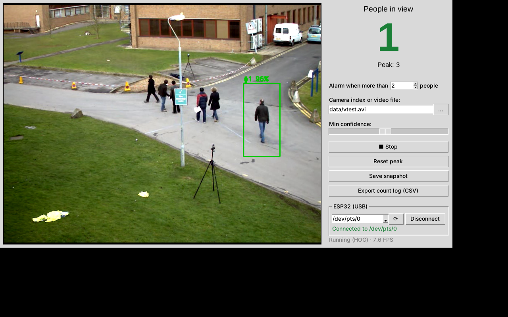
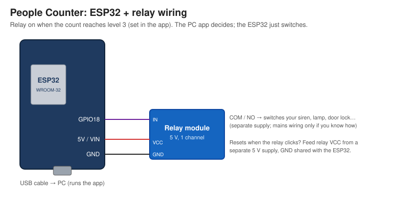

# People Counter

Live camera feed with a box drawn around every person and a large count of how many people are in view.



## Quick start (Windows)
1. Install [Python 3.10+](https://www.python.org/downloads/) and tick **"Add python.exe to PATH"** during setup.
2. Download this repo (**Code → Download ZIP**) and unzip it.
3. Double-click:

| File | What it does |
|---|---|
| `install.bat` | Creates a `venv` folder, installs the packages and offers to install YOLO (optional, ~2 GB) |
| `run.bat` | Starts the app (runs `install.bat` first if needed)|
| `stop.bat` | Closes the running app |

Command-line options can be passed through, e.g. `run.bat --source 1`.

## Manual setup (any OS)
```bash
pip install -r requirements.txt          # Linux also needs: sudo apt install python3-tk
pip install -r requirements-yolo.txt     # optional, much better detection
python app.py                        # default webcam
python app.py --source 1             # second camera
python app.py --source crowd.mp4     # a video file
python app.py --detector hog         # force the lightweight detector
```

## Features
- Live count, plus the peak count since the last reset
- Confidence slider (raise it to cut false detections)
- Save a snapshot of the current frame as PNG
- Export a CSV log with one row each time the count changes
- **Turn on at (people):** three virtual LEDs in the window light up at level 1, 2 and 3 (default 1, 2, 3 people).
  At level 3 the count turns red, the PC beeps and the ESP32 relay switches on

## ESP32: relay
Plug an ESP32 into the PC with a USB cable. The app decides; the ESP32 just switches the relay on
when the count reaches level 3 (set in the app's **Turn on at (people)** box).



| ESP32 pin | Connects to |
|---|---|
| GPIO18 | Relay module **IN** |
| 5V / VIN | Relay module **VCC** |
| GND | Relay module **GND** |

Most relay modules switch on when IN is LOW. If yours is on when it should be off, flip
`RELAY_ACTIVE_LOW` in the firmware. If the ESP32 resets when the relay switches on, power the
relay module VCC from a separate 5 V supply (GND shared with the ESP32).

**Steps**
1. Wire it as shown above.
2. Flash the firmware with the Arduino IDE. Install the **esp32 by Espressif** board package
   (Boards Manager), open `firmware/people_counter_esp32/people_counter_esp32.ino`, select
   **ESP32 Dev Module** and the right COM port, then click Upload.
3. *(Optional)* Test without the app: open the Serial Monitor at 115200 baud and type `R1`.
   The relay should turn on for 3 s.
4. Close the Serial Monitor, then start the app. In the **ESP32 (USB)** panel, pick the COM port and
   click **Connect**. You can also start it with `run.bat --port COM3 --levels 2 5 10`.

**Protocol:** one line per update at 115200 baud: `R1` (relay on) or `R0` (off). The app sends it
whenever it changes, and at least once a second. If nothing arrives for 3 s, the ESP32 turns the
relay off.

## Detectors
| | YOLO (`ultralytics`) | HOG (built into OpenCV) |
|---|---|---|
| Accuracy | High: finds sitting, partly hidden and distant people | Standing people only, misses small ones |
| Speed | Fast with a GPU, fine on a modern CPU | Fast on a CPU |
| First run | Downloads `yolov8n.pt` (~6 MB) | Nothing to download |

With the default `--detector auto`, YOLO is used when it is installed and HOG otherwise.
